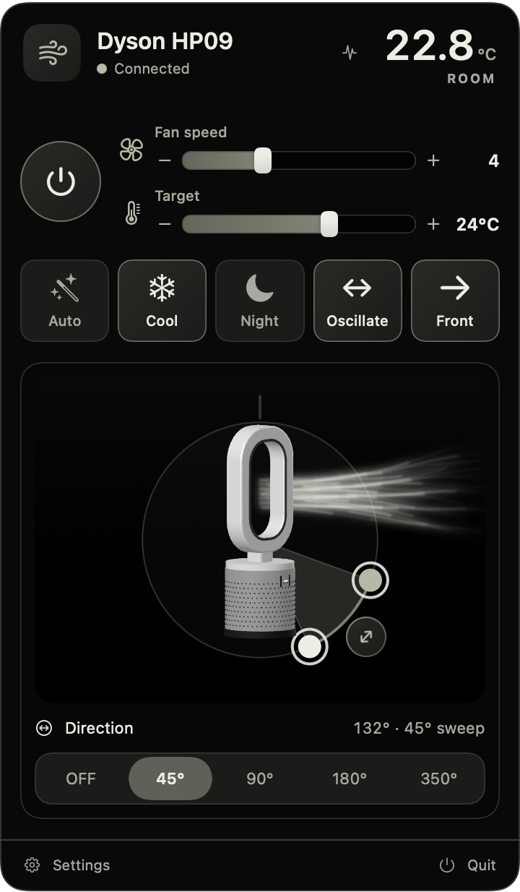

# Dyson macOS Controller

Unofficial native macOS menu-bar controller for compatible Dyson air-treatment devices.

> This is an independent community project. It is not affiliated with, endorsed by, or sponsored by Dyson Ltd. Do not use Dyson logos or copyrighted assets with this project.

## Status

The primary target is the Dyson Purifier Hot+Cool Formaldehyde HP09 (`527K`). The app has a native SwiftUI interface in an AppKit menu-bar popover, local MQTT transport, Bonjour discovery, Keychain storage, and optional MyDyson email/OTP provisioning. Automated tests cover protocol parsing, command validation, reconnect backoff, thermostat logic, and oscillation ranges; compatibility with other models still needs physical-device testing.

## Screenshot



The current interface, rendered from the app's SwiftUI and SceneKit views with sample values. The airflow preview animates while the popover is open and the connected device is on; it respects Reduce Motion. Actual readings and available controls depend on the device.

## Supported functionality

- Power and fan speed 1–10.
- Auto mode, heating, target temperature, oscillation, custom oscillation angles, airflow direction, and night mode.
- A 3D oscillation preview with endpoint handles, a direction handle that moves the whole sweep, and 45°, 90°, 180°, and 350° presets on devices advertising advanced oscillation.
- Room temperature, humidity, PM2.5, PM10, VOC index, and NO₂ index when reported by the device.
- A purifier menu-bar icon with rounded room temperature, plus expandable air-quality details in the popover.
- Local MQTT state subscriptions with a single connection per active device.
- Bonjour discovery with hostname/IP manual fallback.
- Optional MyDyson email/password/OTP provisioning.
- Keychain-only credential storage and redacted diagnostic logging.
- Optional launch at login from **Settings → Devices**.

Controls are capability-gated so additional compatible models can be added without hardcoding the UI to HP09.

## Privacy model

There is no telemetry or analytics. The optional provisioning flow uses HTTPS to Dyson. Normal control and sensor updates stay on the local LAN over plaintext MQTT, normally on port 1883, so use a trusted private network. Access tokens and local MQTT credentials are stored in Keychain; the MyDyson password and OTP remain in memory only for login.

## Installation and first connection

This is currently a source build for local development. There is not yet a notarized download or a Homebrew package.

### Requirements

- macOS 13 or newer.
- Xcode 15 or newer, including Swift Package Manager.
- A Wi-Fi-enabled, compatible Dyson device already configured in the official MyDyson app.
- Your Mac and Dyson device on the same local network for normal control.

### Build the app

Clone the repository, run the fixture tests, build the app bundle, and launch it:

```bash
git clone https://github.com/minhazk/dyson-macos-controller.git
cd dyson-macos-controller
swift test
./script/build_and_run.sh
```

If `swift test` reports that the active developer directory is Command Line Tools, run it with `DEVELOPER_DIR=/Applications/Xcode.app/Contents/Developer swift test` (adjust the path if Xcode is installed elsewhere).

The run script selects Xcode, builds and signs a release app with a stable local identifier requirement, then replaces `/Applications/DysonMenuBar.app` and launches that installed copy. The previous app keeps running until the new build passes signature verification. Your user needs write access to `/Applications`. Use `./script/build_and_run.sh --verify` to run the tests before installing and verify that the Applications copy launches, or `--debug` for a debug build. To build and install without launching, use `DEVELOPER_DIR=/Applications/Xcode.app/Contents/Developer ./scripts/build-app.sh`; this stops the previous app before replacing it.

If macOS shows a security prompt, open the app from Finder and confirm that you built it from this repository. Release signing and notarization are not included yet.

For connection troubleshooting, `./script/build_and_run.sh --settings` opens Devices settings after installing. `--refresh-credentials` also explicitly checks the active device's local credentials against MyDyson using the saved account session, updates Keychain if they changed, and reconnects. Results appear in Diagnostics. Normal startup and reconnects use only the local network.

### Provision through MyDyson

This is the easiest setup path for most users:

1. Open the purifier icon and room-temperature item in the macOS menu bar.
2. Choose **Settings**.
3. Open the **Account** tab and select the country used when your MyDyson account was created.
4. Enter your MyDyson email and choose **Send verification code**.
5. Enter your MyDyson password and the newest email OTP, then choose **Complete login and provision**.
6. The app obtains the device's local MQTT credentials, stores the provisioning data in Keychain, and attempts Bonjour discovery.
7. Return to the menu-bar popover when the device is connected.

Your password and OTP are used for the login request and cleared from the form afterwards. The optional cloud flow is only used to obtain local device credentials; normal device control stays on the local network.

If Bonjour cannot find the device, open **Settings → Devices**, enter the device hostname or IP address, and choose **Save host and reconnect**. A fixed DHCP lease is recommended if your router frequently changes the device's address.

Enable **Launch at login** in **Settings → Devices** to start the app automatically when you sign in to macOS. Always use `/Applications/DysonMenuBar.app`: future builds replace that same copy, keeping the login-item path stable. If you previously enabled startup for a copy in another folder, remove that old entry in **System Settings → General → Login Items & Extensions** and add the Applications copy. To launch manually, open **DysonMenuBar** in Applications or run `open /Applications/DysonMenuBar.app`.

### Manual local MQTT setup

Use this path only if you already have the device's local MQTT details. In **Settings → Devices**, enter the serial number, device model/type, MQTT port, username, password, and root topic. The host is optional when Bonjour discovery is available. Choose **Save securely and connect**; the credentials are stored in Keychain rather than plaintext configuration files.

Do not post MQTT credentials, access tokens, serial numbers, or diagnostic payloads publicly.

### What to expect

- The primary device is the HP09 / `527K`.
- Other Wi-Fi-enabled models may work when their manifest capabilities match, but they are not all live-tested yet.
- Controls are capability-gated, so unsupported heating, oscillation, or sensor features are hidden or disabled.
- The app currently manages one active device at a time.
- A live device is not available in CI; automated tests use synthetic MQTT fixtures.

## Known limitations

- Dyson's private API may change; provisioning errors should be handled through the manual setup flow.
- A live Dyson device is not available in CI, so CI uses only synthetic MQTT fixtures.
- Heating and custom oscillation controls are hidden or disabled when the manifest does not advertise the required capability.
- The app stores and manages one active device at a time; there is no multi-device picker.
- The internal comfort-heating controller is disabled by default and has no user-facing toggle.

## Acknowledgements

Protocol behavior is informed by the community work in [opendyson](https://github.com/libdyson-wg/opendyson), [libdyson-neon](https://github.com/libdyson-wg/libdyson-neon), [appapi](https://github.com/libdyson-wg/appapi), and [ha-dyson](https://github.com/libdyson-wg/ha-dyson). The local transport implements the Dyson-compatible MQTT 3.1 wire protocol directly.
